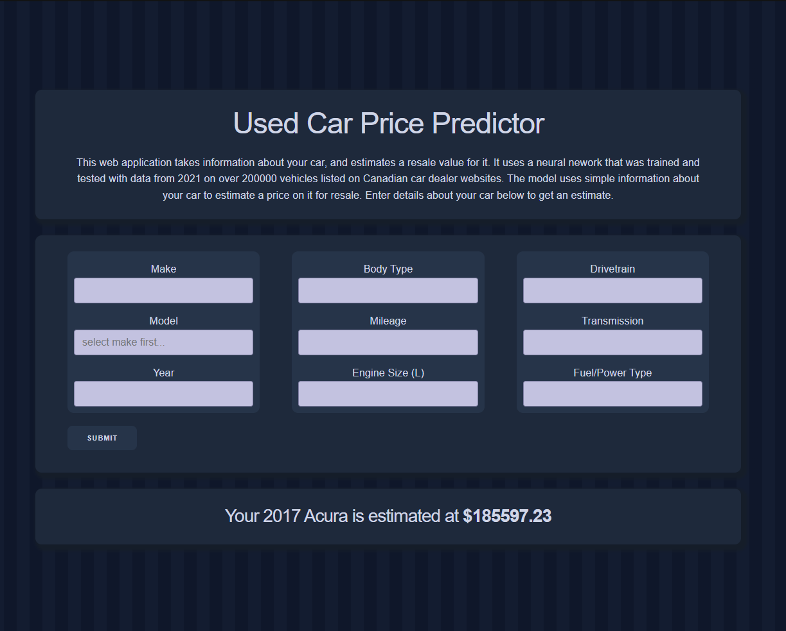
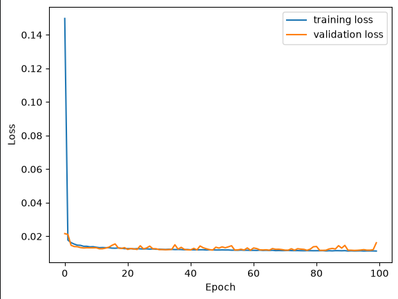

## Used Car Price Prediction
This project uses a PyTorch Lightning neural network to predict car prices base on used car listings from 2021. The model is trained on listings collected from thousands of websites. It includes a Flask web application that serves as an interface for users to pass information to the neural network and receive price predictions back in CAD.

## Demo


## Model Performance
```
| Dataset   | MAE ($) | MAPE (%) |  
| Training  | 2623.51 | 10.62    |  
| Testing   | 2754.60 | 10.99    |
```


## Dataset
The Neural Network is trained on a dataset consisting of over 390,000 vehicle listings collected from thousands of websites in 2021. The dataset contains extensive information like vin, model, and zip code for location of sale. For the purposes of training, 9 fields were selected:
- Make
- Model
- Year
- Body Type
- Mileage
- Engine Size
- Drivetrain
- Transmission
- Fuel Type

## Model
This project uses a feed-forward neural network using PyTorch and PyTorch Lightning. The network takes 64 input features that are preprocessed from 9 fields received from user and uses 4 hidden layers to produce one output value for the estimated vehicle price.
```
| Layer     | Output Size | Activation  |
| Input     | 64          |             |
| Hidden 1  | 512         | ReLU        |
| Hidden 2  | 256         | ReLU        |
| Hidden 3  | 128         | ReLU        |
| Hidden 4  | 64          | ReLU        |
| Output    | 1           |             |
```
## Features
- PyTorch Lightning neural network
- Training pipeline based on the dataset
- Flask web application interface for retrieving user parameters and returning price predictions

## Tech Stack
- Python
- Numpy
- Pandas
- PyTorch
- PyTorch Lightning
- matplotlib
- Flask

## Project Structure
```
├─ assets/                  # README.md images  
│  └─ ...
├─ model_training/
│  ├─ checkpoints/          # Newly trained models from Training.ipynb go here
│  │  └─ ...
│  ├─ Training.ipynb        # Python notebook for data preprocessing and model training
│  ├─ requirements.txt
│  └─ ...
├─ webapp/                  # Flask web application
│  ├─ model/
│  │  ├─ model.ckpt         # Pretrained model
│  │  └─ ...
│  ├─ requirements.txt
│  └─ ...
└─ README.md
```

The repository has two main sections:
- ```model_training/``` contains the dataset, preprocessing and training code and the model.
- ```webapp/``` contains the flask application and any supporting files, including the pretrained model.

## Setup Instructions
### Requirements
- Python 3.14.6
- Git

Clone the repository: 
```a```

### Training a model
*Training not necessary as a pretrained model is included in* ```webapp/model```  

Navigate to ```model_training```:
```bash
cd model_training
``` 

Install the dependencies:
```bash
pip install -r requirements.txt
```

Run the training notebook. The new model will be stored in ```model_training/checkpoints```

### Running the Flask App
Navigate to ```webapp```: 
```bash
cd webapp
```

Install dependencies:
```bash
pip install -r requirements.txt
```

Start the Flask server:
```bash
flask run
```

Open the webapplication in any browser with the url ```http://127.0.0.1:5000```

## Limitations
- The dataset the model was trained on consists of prices from 2021, so the predicted prices may not reflect current market prices.
- Prediction accuracy may vary for different types of cars.
- Used car prices are subjective and can vary based on negotiations between buyers and sellers and any additional factors.